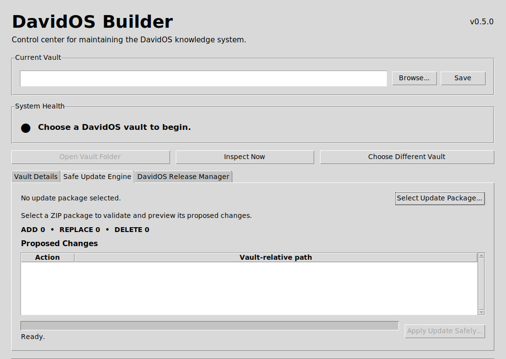

# DavidOS Builder

**Python · Tkinter · Git · Document Management · Workflow Automation**

DavidOS Builder is a desktop application I am developing to maintain and update an interconnected Obsidian knowledge vault. It addresses a practical problem: how to manage many linked documents while reducing accidental changes and making updates easier to inspect and recover.

## What the application does

- **Vault dashboard:** Displays vault information, Markdown document counts, recent document activity, and Git status.
- **Safe Update Engine:** Validates update packages and previews proposed `ADD`, `REPLACE`, and `DELETE` operations before applying changes.
- **Recovery-oriented updates:** Includes backup, rollback, and transaction-report mechanisms for safer file maintenance.
- **Release Manager:** Provides an interface to select documents and prepare named release packages.
- **Validation and testing:** Checks for unsafe paths, invalid operations, and other package errors, supported by automated tests.

## How I developed it

I direct the project through an iterative, AI-assisted development process: defining requirements, reviewing implementation choices, testing, troubleshooting, and refining the workflow. My operations and legal-support background informs the emphasis on accuracy, accountability, and recoverability.

## Current status

**Working prototype under active development.** The application runs as a Python/Tkinter desktop interface. Its current screens include **Vault Details**, **Safe Update Engine**, and **DavidOS Release Manager**. I have run the application in a GitHub Codespace through a virtual graphical display to inspect its actual interface.

The source repository is private. This public overview describes the project without publishing its code.

## Application screenshot

*Actual application interface captured during a GitHub Codespaces session.*
